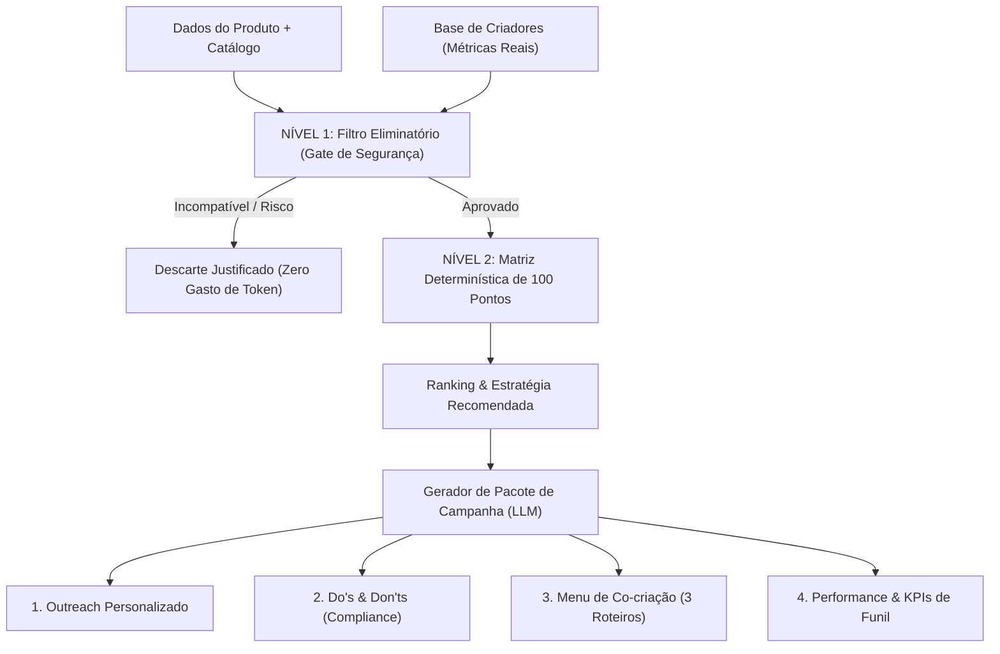

# Do Produto ao Criador: Como LLMs e Regras Determinísticas Automatizam Parcerias Comerciais no Marketing Digital

> **Autor:** [Seu Nome]  
> **Trilha:** Bootcamp Bradesco — Agentes de IA: do Zero à Prática (DIO)  
> **Tema:** Aplicações Práticas de LLMs em Contexto Profissional  

---

## 1. Introdução e o Problema de Negócio

No ecossistema do comércio eletrônico e do varejo, lojas de variedades enfrentam um dilema clássico de aquisição de clientes: possuem catálogos diversificados (de maquiagens a organizadores e acessórios tecnológicos), mas operam com margens enxutas e sem equipes dedicadas de marketing de influência.

Quando tentam contratar influenciadores para divulgar seus produtos, essas empresas cometem erros frequentes:
1. **Miopia da métrica de vaidade:** Contratam criadores baseando-se exclusivamente no número bruto de seguidores, ignorando demografia e nicho.
2. **Custo de busca e triagem manual:** Gastam horas minerando feeds do Instagram e TikTok sem critérios objetivos.
3. **Comunicação genérica e engessada:** Enviam abordagens impessoais (*cold DMs*) ou briefings engessados que desrespeitam a linguagem nativa do criador.
4. **Ausência de governança e rastreabilidade:** Não estabelecem diretrizes de conformidade (*compliance* publicitário) nem medem o retorno com base em dados de funil.

Do outro lado, micro e médios criadores de conteúdo sofrem para encontrar marcas que façam sentido para suas audiências, recusando propostas que conflitam com suas linhas editoriais.

O problema central, portanto, não é encontrar influenciadores com audiência, mas sim **orquestrar um matchmaking algorítmico, comercial e criativo entre Produto, Audiência e Criador**.

---

## 2. A Solução: Arquitetura Híbrida (LLMs + Regras Determinísticas)

Uma falha comum em projetos acadêmicos ou amadores de IA generativa é delegar ao modelo de linguagem toda a tomada de decisão sem parâmetros de controle. Isso gera notas arbitrárias e alucinações de métricas.

Neste projeto, adotamos uma **arquitetura híbrida em dois níveis**, inspirada em metodologias de auditoria de agências profissionais:

### Os Dois Níveis de Análise:
* **Nível 1 — Gate Eliminatório:** Filtra previamente perfis com inconsistência demográfica evidente, indícios de fraude de audiência ou choque frontal de linha editorial antes de processar etapas custosas.
* **Nível 2 — Matriz Determinística de 100 Pontos:** Em vez de pedir uma "nota livre", o LLM é instruído a preencher rubricas com pesos fixos:
  1. *Afinidade Temática e Nicho:* 20 pontos
  2. *Compatibilidade Demográfica da Audiência (Gênero e Idade):* 20 pontos
  3. *Engajamento e Autenticidade:* 20 pontos
  4. *Capacidade de Produção Audiovisual:* 15 pontos
  5. *Potencial de Conversão / Ticket Médio:* 15 pontos
  6. *Viabilidade Comercial e Reputacional:* 10 pontos

---

## 3. O Experimento Prático com Dados Reais

Para testar a consistência do sistema, simulamos uma campanha para a loja fictícia **Mix Variedades** com o seguinte produto de teste:

* **Produto:** Gloss Labial Efeito Volume
* **Preço de Venda:** R$ 29,90 (Ticket Acessível)
* **Categoria:** Beleza & Cosméticos
* **Público-Alvo Almejado:** Mulheres de 18 a 32 anos
* **Objetivo Comercial:** Conversão rápida, demonstração de textura e viralização

Submetemos o produto a um teste comparativo com figuras públicas reais e suas respectivas métricas e arquétipos de audiência:

| Criador (Referência Real) | Nicho Principal | Base & Métricas Públicas | Demografia Real Estimada | Status no Gate | Score (100 pts) | Veredito Estratégico |
|---|---|---|---|:---:|:---:|---|
| **Joyce Kitamura** | Beleza, Skincare e Cosméticos | ~600k Instagram / 1.2M YouTube | >85% Feminino (20–35 anos) | **Aprovada** | **95 / 100** | **Recomendada (Autoridade Técnica)** |
| **Camila Pudim** | Makes Artísticas & Vídeos Virais | ~4.5M Instagram / Alto Reels | 75% Feminino (16–28 anos) | **Aprovada** | **88 / 100** | **Recomendada (Volume & Viralização)** |
| **Amanda Looks** | Achadinhos & Moda | 27k Instagram | 88% Feminino (18–35 anos) | **Aprovada** | **87 / 100** | **Recomendada (Match Comercial)** |
| **Nath Finanças** | Educação Financeira Popular | ~550k Instagram / Foco em economia | 70% Feminino (25–34 anos) | **REPROVADA** | — | **Reprovada por Risco Reputacional / Conflito Editorial** |
| **Casimiro Miguel (Cazé)** | Futebol, Games & Entretenimento | >4M Instagram / CazéTV | >75% Masculino (18–34 anos) | **REPROVADA** | — | **Reprovado no Gate Demográfico (< 15 pts)** |

### Insights de Engenharia dos Testes:
1. **Evitando Desperdício de Capital:** Criadores com milhões de seguidores (Casimiro) foram barrados imediatamente no primeiro filtro demográfico, impedindo que a loja queime orçamento por causa de números de vaidade.
2. **Sensibilidade a Risco e Ética Editorial (Caso Nath Finanças):** O sistema identificou que, embora a demografia da influenciadora tenha forte adesão feminina, sua proposta de valor é focada em *educação financeira contra compras por impulso*. Sugerir um cosmético de apelo imediato violaria a credibilidade da criadora, demonstrando a acurácia contextual do modelo.

---

## 4. Engenharia de Prompts: O Pacote de Campanha em 4 Módulos

Quando o influenciador é aprovado no ranking (caso de **Joyce Kitamura**), o sistema aciona o segundo estágio: um prompt estruturado que não gera um texto estático, mas sim um **pacote operacional completo**.

### 4.1. Módulo 1: Outreach de Primeiro Contato (Direct / E-mail)
> *"Oi Joyce, tudo bem? Acompanhamos como você prioriza a honestidade e a transparência ao testar cosméticos, especialmente ao mostrar textura, conforto e acabamento real nos lábios sem filtros de desfoque. Estamos com o lançamento do Gloss Labial Efeito Volume (R$ 29,90) na Mix Variedades e queremos muito sua avaliação sincera. Gostaríamos de enviar um kit para teste e apresentar uma proposta para um vídeo curto demonstrativo. Se fizer sentido para sua rotina, podemos te enviar mais detalhes por aqui?"*

### 4.2. Módulo 2: Diretrizes de Conformidade (*Do's & Don'ts*)
* **O que FAZER (Do's):**
  - Exibir a textura real e o aplicador em close sob luz natural ou ring light suave.
  - Deixar explícito que o efeito de volume vem da hidratação e do acabamento espelhado (sem dor ou ardor).
  - Incluir a identificação obrigatória de publicidade (`#publi` ou ferramenta de parceria paga).
* **O que NÃO FAZER (Don'ts):**
  - Não comparar pejorativamente com outras marcas registradas.
  - Não fazer alegações falsas de preenchimento médico definitivo ou substituição de procedimentos estéticos.
  - Não usar filtros de edição que alterem a cor ou a viscosidade do produto.

### 4.3. Módulo 3: Menu Criativo Colaborativo (3 Opções de Roteiro)
Para evitar que o criador receba um roteiro engessado, o sistema oferece três alternativas de co-criação:

1. **Opção 1 — Trend de Mercado (Benchmark Viral):** Formato *"Lip Combo Acessível"*, demonstrando como contornar os lábios e finalizar com o gloss para alcançar o visual de produtos de luxo por menos de R$ 30,00.
2. **Opção 2 — Formato Nativo Técnico (Resenha & Primeira Impressão):** Close no aplicador, aplicação em tempo real com comentários sobre sensorial, fixação e ausência de viscosidade pegajosa.
3. **Opção 3 — Formato Contextual ("Arrume-se Comigo"):** Inserção fluida na finalização de uma maquiagem rápida de 5 minutos do dia a dia.

### 4.4. Módulo 4: Governança de Performance e KPIs de Funil
O modelo já gera o setup completo de mensuração de resultados:
* **Parâmetro UTM:** `mixvariedades.com.br/gloss-volume?utm_source=instagram&utm_medium=influencer&utm_campaign=lancamento_gloss&utm_content=joyce_kitamura`
* **Cupom de Conversão Direta:** `JOYCE10` (10% de desconto)
* **Matriz de Indicadores de Sucesso (Benchmarks):**
  - *Hook Retention (3s):* Meta $> 55\%$
  - *Taxa de Salvamentos:* Meta $> 3\%$ do alcance (indicador de intenção de compra)
  - *CTR do Link na Bio:* Meta $> 2,5\%$
  - *Taxa de Conversão de Vendas (Checkout):* Meta $> 1,8\%$
  - *ROAS Alvo da Parceria:* $> 2.5\times$ o investimento total

---

## 5. Prototipação e Interface (Validação Visual)

Para tornar a solução tangível e comercialmente aplicável, o fluxo de dados e os prompts foram modelados em uma interface interativa de dashboard inspirada no **Dribbble** e prototipada no **Lovable**.

A tela central da aplicação permite que a equipe da loja:
1. Alterne o catálogo de produtos com um clique.
2. Visualize instantaneamente a tabela de influenciadores ranqueados com barras de progresso coloridas de compatibilidade (verde para $>85$, amarelo para $60-84$ e vermelho para reprovados).
3. Abra o modal de campanha para copiar o pacote completo de mensagens, roteiros e parâmetros de rastreamento com governança prévia.

---

## 6. Limitações Técnicas e Próximos Passos

Um projeto maduro de engenharia de software precisa reconhecer as fronteiras de sua implementação:

1. **Dependência de Dados Atualizados:** A qualidade da pontuação do LLM é limitada à fidelidade dos dados demográficos e taxas de engajamento fornecidos. Em um ambiente de produção, o sistema deve se conectar a APIs oficiais de redes sociais ou ferramentas de auditoria (ex.: HypeAuditor, Modash).
2. **Variação Algorítmica das Redes:** Um score de 95/100 indica alta probabilidade de sucesso estratégico, mas o desempenho final depende de fatores externos como o algoritmo da plataforma no dia da postagem e sazonalidade comercial.
3. **Evolução para Agentes Autônomos:** Como evolução futura, este projeto pode ser orquestrado via frameworks de múltiplos agentes (CrewAI, LangGraph), onde um agente atua como Auditor de Dados, outro como Estrategista de Roteiro e um terceiro como Gestor de Disparo e Monitoramento de Cupons via API do e-commerce.

---

## 7. Conclusão

A aplicação de modelos de linguagem no marketing digital não deve se limitar a "gerar textos criativos". Quando combinados com matrizes de decisão determinísticas, critérios eliminatórios de negócio e métricas reais de funil, os LLMs tornam-se ferramentas operacionais poderosas.

Este projeto demonstrou que pequenos negócios podem, sim, executar campanhas com o mesmo nível de precisão, governança e estratégia de grandes agências, poupando tempo, evitando desperdício de verba e criando parcerias mutuamente rentáveis com criadores de conteúdo.

---
*Projeto desenvolvido como parte do Bootcamp Bradesco — Agentes de IA: do Zero à Prática na Digital Innovation One (DIO).*
